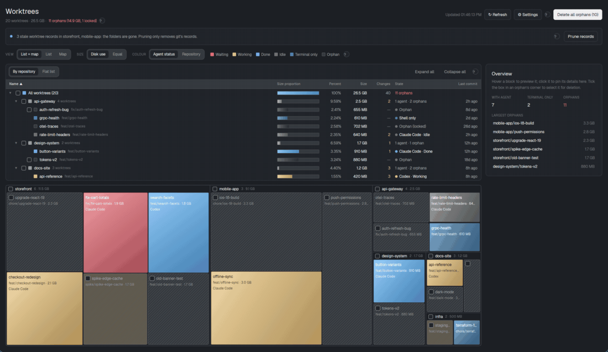
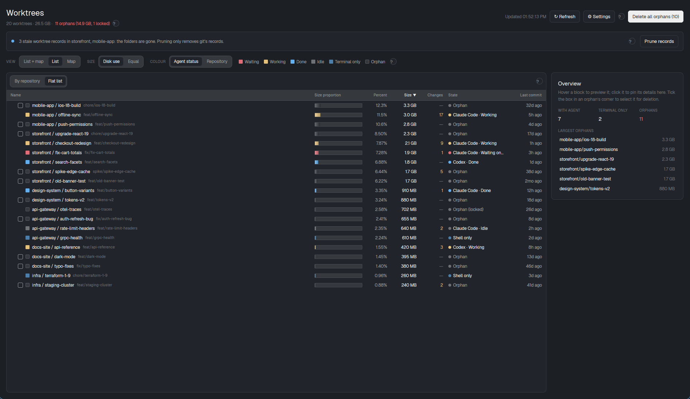
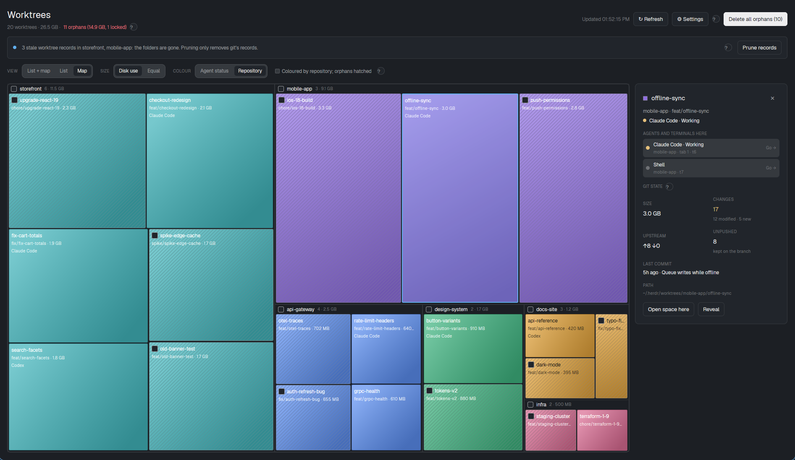
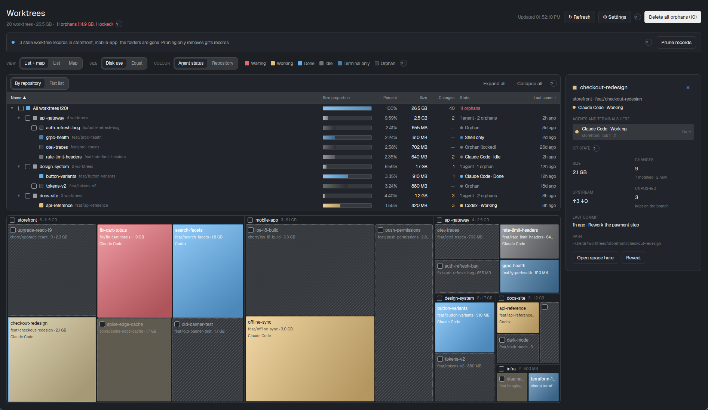
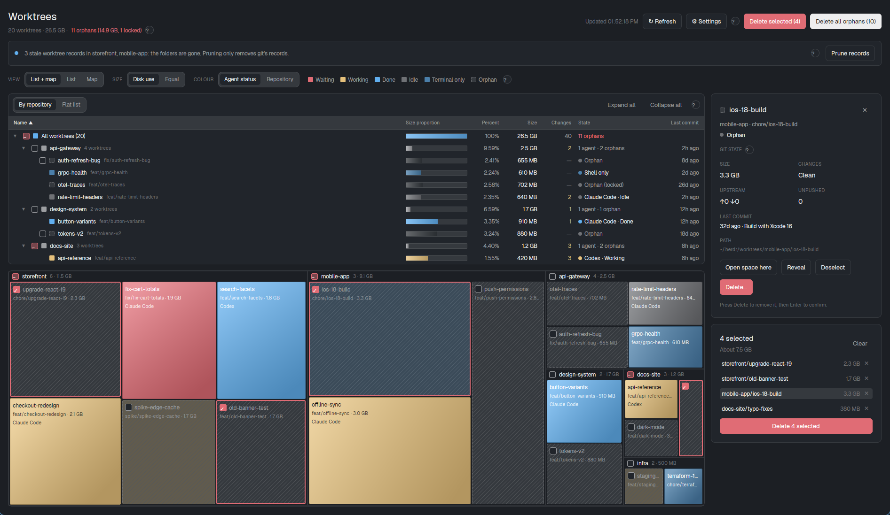
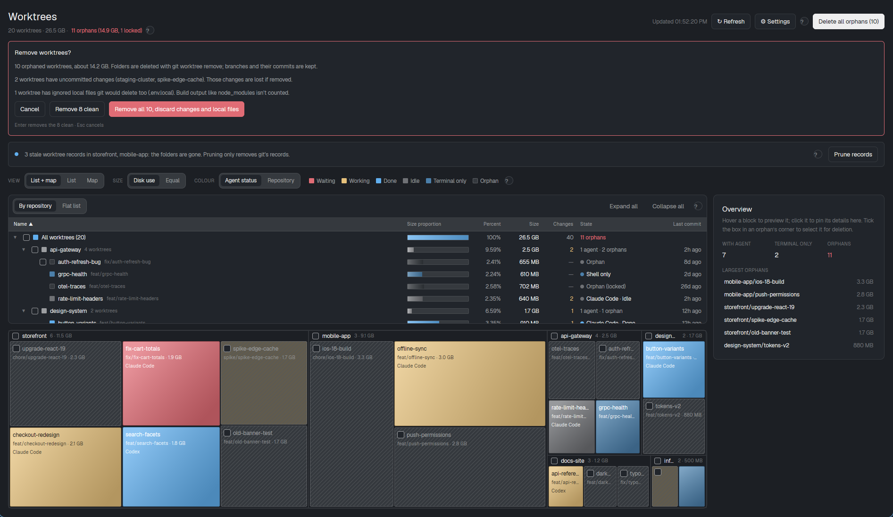
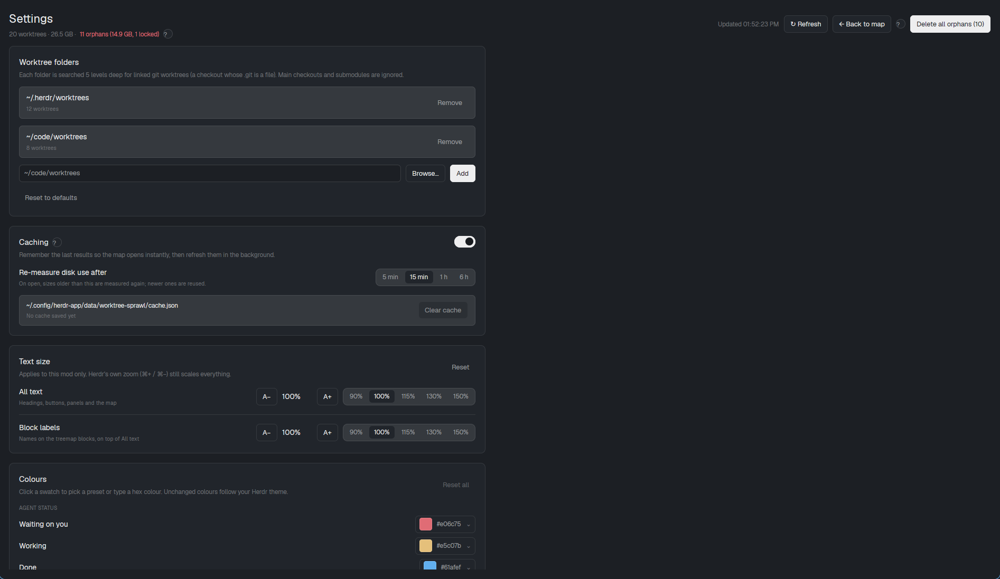
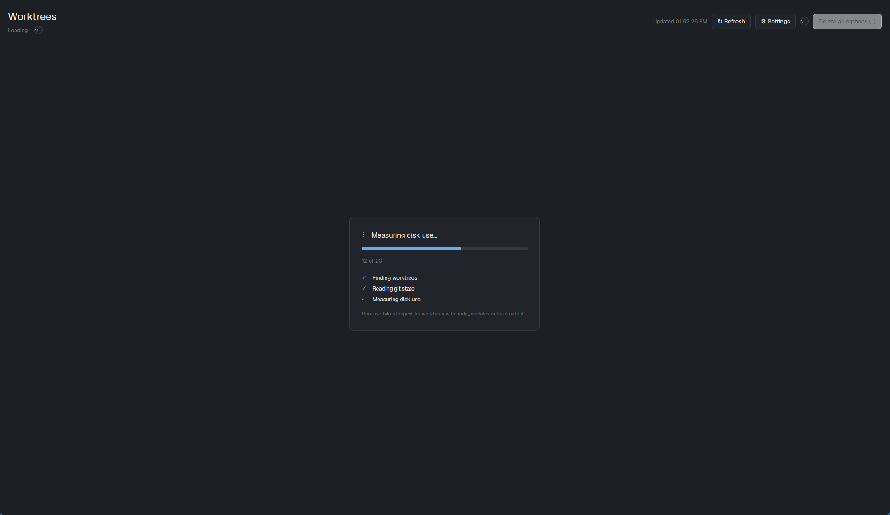

# worktree-sprawl

A [Herdr](https://herdr.dev) app mod: every git worktree on your machine in one tab, the way WinDirStat shows a disk. A sortable list sits above a treemap where each worktree is a block sized by its disk use and colored by the agent working in it. Worktrees that no terminal or agent is using (orphans) are hatched, counted in red, and can be removed one at a time, per repository, or all at once.

Coding agents make worktrees cheap to create and easy to forget. A few weeks of that leaves dozens of checkouts, each with its own `node_modules`, and no quick way to tell which ones are still in use. Worktree Sprawl shows which are live, which are abandoned and how much disk each one holds, and cleans up the abandoned ones with `git worktree remove`. Branches are always kept.



## What it shows

| You want to know | Look at |
|---|---|
| Where the disk went | The **treemap**: one region per repository, one block per worktree, sized by disk use. Switch **Size** to Equal to compare by count instead. |
| Which worktrees are in use | Block colors: **Waiting on you**, **Working**, **Done**, **Idle** for agents, **Terminal only** for a plain shell. Switch **Colour** to Repository to color by repo instead. |
| Which are abandoned | Hatched blocks with a dashed border, and the bold red "N orphans (size)" in the header. |
| The details of one | Click a block or a row. The side panel pins its agents and terminals (click one to jump to it), branch, uncommitted changes, ahead/behind, unpushed commits, last commit and path. |
| The biggest, the oldest, the dirtiest | The **list**: grouped by repository, or one flat list sorted by size, changes, state or last commit. |

## Screens

The repositories shown are demo data.


### The list

Two modes. **By repository** is a tree, always sorted by name: an "All worktrees" row, a row per repository that folds, and its worktrees beneath. **Flat list** puts every worktree in one list named `repo / worktree`, sorted by whichever heading you click; click again to reverse. Clicking any heading other than Name while grouped switches to the flat list, so the column always reads in order from top to bottom.

Every column sorts by the value it shows. Last commit sorts by age, so ▲ is newest first. State ranks waiting, done, working, idle, terminal only, orphan. Values that aren't known yet (a size still being measured, a worktree with no commit) go last in both directions.

Size bars are a share of the parent: a repository's share of the total, a worktree's share of its repository. The percent column is always a share of the total.



### The map

Each repository is a bordered region with a header (name, worktree count, size); its worktrees are laid out inside as a squarified treemap. A block big enough to hold text is labelled with its name, branch, size and agents. A tiny worktree next to a huge one is given a minimum area so it can still be hovered; its real size is in the label and the list.

Hovering a block previews it in the side panel. Clicking pins it, so the panel stays put while you move the pointer over to it. Click again, press ✕, or click empty space in the region to unpin.

**View** switches between List + map, List and Map.



### The side panel

With nothing pinned or hovered it shows an overview: counts of worktrees with an agent, with only a terminal, and orphaned, plus the largest orphans. For a worktree it shows the agents and terminals inside, the git state, the last commit and the path, with **Open space here**, **Reveal** (opens the folder in your file manager) and, for an orphan, **Select to delete**.



### Removing orphans

A worktree is an orphan when no live terminal on this machine has its working folder inside it. That is worked out from Herdr's live data on every redraw, so it follows agents starting and stopping.

Select orphans with the checkbox on a block or row, the group checkbox on a repository (all of its orphans), or **Select to delete** in the panel. **Delete selected** and **Delete all orphans** both open a confirmation listing the count and size first.

For one worktree the quick way is the keyboard: click an orphan, press **Delete** (or Backspace), then **Enter**. Delete opens the confirmation for the worktree in the panel, or for every selected orphan when some are ticked; the panel's **Delete…** button does the same. In the confirmation, Enter removes the clean worktrees and **Esc** cancels. Discarding uncommitted changes or local files has no key: that always takes a click on its button. Esc also unpins a worktree.

- Worktrees with uncommitted changes, or with ignored local files that git would delete along with the folder (`.env`, local config; build output such as `node_modules` and `dist` doesn't count), are listed separately with a sample of the files. You choose between removing only the clean ones and removing all of them.
- Removal runs `git worktree remove` one worktree at a time. `--force` is used only for a worktree with uncommitted changes, and only after you chose to discard them.
- Right before each removal the mod checks again that no terminal is inside and that the worktree isn't locked. If the lock state can't be read, the worktree is skipped.
- Worktrees locked with `git worktree lock` can't be selected.
- Branches are never deleted, so unpushed commits stay on their branch.
- The delete buttons are enabled only after a complete scan and measurement in this session, never from cached results.

| Orphans selected | The confirmation |
|---|---|
|  |  |

### Stale records

When a worktree's folder was deleted by hand, git still has a record of it. A bar lists how many such records exist and in which repositories; **Prune records** runs `git worktree prune` in each. Pruning removes only git's records.

### Settings

**⚙ Settings** holds:

- **Worktree folders:** the folders to scan, each with its worktree count or the error it gave. Herdr's `~/.herdr/worktrees` is there by default; add the others you use. Each folder is searched 5 levels down, skipping `node_modules`, `.venv` and `.terraform`.
- **Caching:** on by default. Opening the tab shows the last results at once and refreshes in the background; disk sizes are measured again after 5 minutes, 15 minutes, 1 hour or 6 hours. Turning caching off deletes the cache file.
- **Text size:** all text, and the map's block labels separately, from 80% to 175%.
- **Colours:** every agent-status, orphan, selection and repository color, with presets or a hex value.



### The first scan

With no cache yet, a progress card shows the step and count while worktrees are found, read and measured.



## What it runs and writes

- **Runs:** `find`, `git` and `du` to discover and measure worktrees, `/bin/sh` to resolve symlinks, and `xdg-open` / `open` / `explorer` for Reveal.
- **Changes your repositories** only through `git worktree remove` and `git worktree prune`, and only after you confirm.
- **Writes** one file, `~/.config/herdr-app/data/worktree-sprawl/cache.json` (the worktree list, git status counts and sizes). Turn caching off in Settings to remove it.
- **Network:** none.

## Requirements

- **Herdr:** `herdr-app` and `herdr-core` (`hc`) installed and running. Built with `herdr-app 0.1.15`; currently run on `herdr-app 0.1.16` and `hc 0.1.21`.
- **git** 2.31 or newer (for `git rev-parse --path-format=absolute`).
- **Linux or macOS.** The mod runs `find`, `du` and `/bin/sh` and works with `/` paths, so it does not run on Windows.
- Only worktrees and terminals on this machine are shown; spaces on other machines aren't scanned.

## Install

Copy `mods/worktree-sprawl/` to `~/.config/herdr-app/mods/`, check it, and open it as a tab:

```sh
cp -R mods/worktree-sprawl ~/.config/herdr-app/mods/
herdr-app check ~/.config/herdr-app/mods/worktree-sprawl
herdr-app do tab.new --name Worktrees --mod worktree-sprawl
```

Or ask your agent to install it from this repo; `RECIPE.md` describes the whole mod.

Then open **⚙ Settings** and add the folders your worktrees live in.

**A Worktrees button in the tab bar (optional).** Add the block in `layout-snippet.json` to a row of a layout of your own, such as the row that holds the `tabs` block. Herdr's shipped layouts are read-only, so clone one first:

```sh
herdr-app do layout.clone '{"name":"main","as":"my-main"}'
```

The button focuses the Worktrees tab in the current space, or opens one.

**A key (optional).** Add a binding to the `global` section of `~/.config/herdr-app/keys.json`, with any key you like:

```json
"ctrl-alt-w": { "command": "tab.new", "args": { "name": "Worktrees", "mod": "worktree-sprawl" } }
```

## Updating

Herdr doesn't update community mods for you, so how you update depends on how you installed. Your folders, colors and other settings are kept in Herdr's shared state, and the cache under `~/.config/herdr-app/data/`, both outside the mod folder, so an update never touches them.

**Installed as a symlink to a clone (easiest).** Install it this way once:

```sh
git clone https://github.com/cgill27/worktree-sprawl.git ~/code/worktree-sprawl
ln -s ~/code/worktree-sprawl/mods/worktree-sprawl ~/.config/herdr-app/mods/worktree-sprawl
```

Then update with a pull. Herdr reloads a mod as soon as its files change, so there is nothing to restart:

```sh
git -C ~/code/worktree-sprawl pull --ff-only
```

**Installed by copying the folder.** Pull or download the new version and replace the installed folder, keeping the `.d.ts` files Herdr generates there:

```sh
rsync -a --delete --exclude='*.d.ts' ~/code/worktree-sprawl/mods/worktree-sprawl/ ~/.config/herdr-app/mods/worktree-sprawl/
```

## Troubleshooting

**The first scan is slow.** Measuring a worktree with `du` takes seconds when it holds `node_modules` or build output, so a first scan of a few dozen worktrees can take 5 to 30 seconds. After that the cache shows the last results at once.

**A worktree is missing.** Its folder isn't under any folder listed in Settings, or it is more than 5 levels below one. Main checkouts and submodules are left out on purpose: only linked worktrees are shown.

**The delete buttons are disabled.** They stay off while a scan, a measurement, a removal or a prune is running, and until one full scan and measurement has finished in this session. Press **↻ Refresh** and wait for "Updated".

**A worktree in use shows as an orphan.** Orphan status depends on a live terminal's folder being inside the worktree. A terminal on another machine, or one outside Herdr, doesn't count. Check before deleting.

**"Scan failed" on opening.** On Windows, or with git missing or older than 2.31, the tab says so under "Scan failed" instead of showing an empty list. After updating git, press **↻ Refresh**.

**Errors.** `herdr-app status` lists errors from mods. Cache problems are logged with the prefix `worktree-sprawl:`.

## Development

```sh
node --test tests/                           # the list's sort rules, the platform and git checks
herdr-app check mods/worktree-sprawl         # loads and renders the mod once
```

`herdr-app check` doesn't run click handlers or later states, so also try a change in the running app. Test removal against throwaway worktrees (`git worktree add /tmp/wt-test-1 -b wt-test-1`, then add `/tmp` in Settings), never real work.

**Screenshots.** Copy `docs/demo.json` to `~/.config/herdr-app/data/worktree-sprawl.demo` and open a new Worktrees tab: the mod shows the made-up worktrees in that file and scans, caches, removes and prunes nothing. Keys such as `"pinned": "storefront/checkout-redesign"`, `"selected"`, `"confirm": "orphans"`, `"settings": true` and `"view"` open it in a given state; `mods/worktree-sprawl/demo.js` lists them all. The file is read when a tab opens, so reopen the tab after changing it, capture with `herdr-app shot`, and delete the file afterwards.

The `.d.ts` files in the mod folder are written by Herdr and not committed. `RECIPE.md` is the brief for building the mod from scratch.

## License

[MIT](LICENSE)
