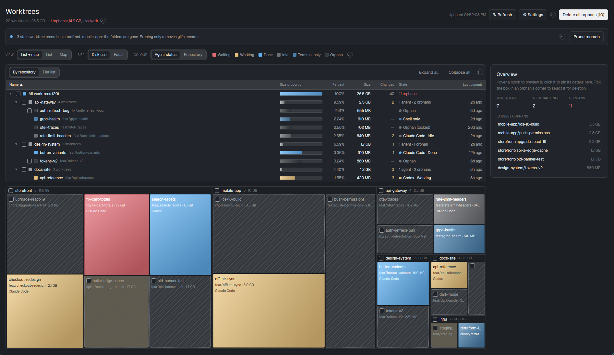

# Worktree Sprawl

A full-window Herdr app that shows every git worktree on the machine the way
WinDirStat shows a disk: a sortable tree list on top and a treemap below, where
each worktree is a block sized by its disk use and colored by the agent working
in it. Hovering or clicking a worktree shows its agents, branch and git state in
a side panel. Worktrees with no terminal or agent in them ("orphans") are
hatched and can be removed one by one, per repository, or all at once, always
after a confirmation and always with `git worktree remove` (branches are kept).

## What you see

The mod opens as a tab whose only pane is the mod (`tab.new {name: "Worktrees",
mod: "worktree-sprawl"}`), filling the work area. A second copy of the mod with
`props: {mode: "toolbar"}` is a small "Worktrees" button (icon + label, 26px
high, chrome background, hover background) placed in the layout's tab-bar row,
next to other launcher buttons. Clicking it focuses the existing Worktrees tab
in the active space or opens one.

Inside the tab, top to bottom, on the theme's `canvas`, padded 16px:

1. **Header.** Title "Worktrees" (20px semibold; "Settings" on the settings
   page). Under it a summary: "36 worktrees · 11.8 GB ·" in muted text followed
   by "**25 orphans (11.5 GB)**" in bold, red (`destructive`) when there are
   orphans, then a `?` help button. On the right: a status line with a braille
   spinner while scanning or measuring ("Scanning…", "Showing cached results from
   11:02 · updating…", "Measuring disk use… 12/36", "Updated 11:14"), a `?`
   about deleting, **↻ Refresh** (outline), **⚙ Settings** / **← Back to map**
   (outline), **Delete selected (n)** (red, only when something is selected) and
   **Delete all orphans (n)** (primary).
2. **Bars that come and go:** a red-bordered confirmation card ("Remove
   worktrees?") while confirming; a progress notice while removing; a card
   listing worktrees that couldn't be removed (with Dismiss); and a one-line
   **stale records** bar ("34 stale worktree records in repoA, repoB +2: the
   folders are gone. Pruning only removes git's records.") with a `?` and
   **Prune records**. Hovering the bar's text lists the missing folders.
3. **Legend row:** segmented controls **View** (List + map / List / Map),
   **Size** (Disk use / Equal), **Colour** (Agent status / Repository), then
   color chips (Waiting, Working, Done, Idle, Terminal only, Orphan with a
   dashed border) and a `?` explaining the map.
4. **Body:** a row with the left column (flex) and the side panel (330px, scaled
   with text size up to 1.45×).
   - **List** (top 42% of the left column in List + map, or all of it): a card
     with a toolbar (segmented **By repository / Flat list**, **Expand all**,
     **Collapse all**, `?`), a header row of sortable columns and scrolling rows.
     Columns: Name (flex) · Size proportion (132px bar) · Percent (62) · Size (74)
     · Changes (66) · State (160) · Last commit (86). The active sort column shows
     ▲/▼.
     - *By repository:* an "All worktrees (36)" root row (100%, total size, orphan
       count in bold red), then one row per repository (▾/▸ chevron, group
       checkbox, swatch, bold name, "5 worktrees", totals), then its worktrees
       indented (orphan checkbox or a spacer, colored swatch (dashed for orphans),
       name, branch dimmed, bar, %, size, changes in amber when nonzero, a status
       dot with "Claude Code · Working" / "Shell only" / "Orphan", age).
     - *Flat list:* every worktree flat, named "repo / worktree", sorted top to
       bottom by the chosen column.
     - Size proportion bars are a share of the parent (repo of total, worktree of
       repo; of total in flat mode), drawn with a left-to-right lighter-to-darker
       gradient in the block's color. Percent is always of the total.
   - **Treemap** (the rest): a rounded card. Each repository is a region with a
     1px border and a 20px header (group checkbox, bold repo name, "5 · 1.6 GB"),
     and its worktrees are blocks inside, laid out with a squarified treemap.
     Blocks have a 1px border and 3px radius and a 135° "cushion" gradient
     (28% lighter top-left to 22% darker bottom-right) over their color, like
     WinDirStat. Labels when the block is big enough: name (bold), then
     "branch · size", then the agents' names. Orphans are the orphan color with a
     diagonal hatch (`pattern_slash`) and a dashed border, with a checkbox in the
     top-left corner; orphans with uncommitted changes get an amber tint.
   - **Side panel:** shows the pinned worktree, else the hovered one ("Previewing
     · click the block to keep it here"), else an **Overview** card (counts With
     agent / Terminal only / Orphans, and a "Largest orphans" list). The details
     card has the name with a ✕ to unpin, repo · branch, a status line, a list of
     the agents and terminals inside (click to jump), **Git state** with `?`
     (Size, Changes, Upstream ↑↓, Unpushed), Last commit (age · subject), Path,
     and buttons **Open space here**, **Reveal**, and for orphans **Select to
     delete** / **Deselect**. When anything is selected, a **"n selected"** card
     lists them (click a name to pin it, ✕ to deselect) with **Delete n
     selected**.
5. **Settings page** (scrolling, max 820px wide): cards **Worktree folders**
   (list with worktree counts or the error, Remove; an input with Browse… and
   Add; Reset to defaults), **Caching** (toggle with `?`; "Re-measure disk use
   after" 5 min / 15 min / 1 h / 6 h; the cache file path, last saved time and
   **Clear cache**), **Text size** (All text and Block labels, each A− / % / A+
   in 5% steps from 80% to 175% plus presets 90/100/115/130/150%; Reset),
   **Colours** (Agent status: Waiting on you, Working, Done, Idle, Terminal
   only; Orphans and selection: Orphan block, Uncommitted-changes tint, Selected
   for deletion, Pinned outline; a 10-color Repository palette; each a swatch
   button opening a picker with 24 presets, a hex field with Apply, and Use
   default; "custom" tag; Reset all), and a short "What counts as an orphan".
6. **First load** (no cache yet): instead of the list and map, a centered card
   with a spinner and the current step ("Finding worktrees…", "Reading git
   state…", "Measuring disk use…"), a 320px progress bar with "12 of 36", the
   three steps ticked off, and a note that du is slow with node_modules.

All colors come from `theme()` unless the person picks their own.

## How it behaves

- **Agent status colors** (status mode): blocked "Waiting on you" =
  `theme().blocked`, done = `done`, working = `working`, idle = `idle`; a block
  takes its most urgent agent (blocked > done > working > idle). A worktree with
  only a shell open is "Terminal only" (accent mixed 35% toward the surface).
  Orphans use `raised`. In repository mode blocks use a 10-color palette by
  repository; orphans keep the hatch.
- **States:** a worktree is *agent* if any live local terminal whose folder
  (`panes().cwd`, else `terminals().cwd`) is inside it is an agent; *terminal* if
  only non-agent terminals are; *orphan* otherwise. This is recomputed on every
  render from Herdr's live data, so it follows agents starting and stopping.
- **Hover** a block or row: accent outline on the block, row background, and a
  preview in the side panel only when nothing is pinned. A plain tooltip gives
  "repo/worktree · size · state".
- **Click** a block or row: pins it (2px outline in the pinned color plus a 15%
  wash); the panel stays on it while the pointer moves. Click again, press ✕,
  or click empty space in a repository region to unpin. Clicking a repository
  row folds or unfolds it.
- **Selecting for deletion:** the checkbox on an orphan block or row (selecting
  also pins it), the group checkbox on a repository row or map header (all /
  some "–" / none of its orphans), the checkbox on "All worktrees", or **Select
  to delete** in the panel. Selected blocks get a 2px border in the selected
  color with ✓.
- **Deleting:** **Delete all orphans** and **Delete selected** open the
  confirmation listing count and size. Worktrees with uncommitted changes, or
  with ignored *local* files git would delete too (`.env`, local config; build
  output such as node_modules, dist, bin/obj doesn't count), are listed
  separately with a sample of the files; it offers "Remove N clean" or "Remove
  all N, discard changes / local files". Removal runs
  `git -C <repo> worktree remove [--force] <path>` one at a time (`--force` only
  for uncommitted changes, after that choice). Right before each one it resolves
  symlinks and re-checks that no live terminal is inside and that
  `git worktree list --porcelain` still reads and doesn't show it locked
  (unreadable lock state = skip). Then `git worktree prune` per repo, a toast
  ("Removed 4 worktrees · Freed about 2.1 GB. Branches were kept."), and a
  rescan. Branches are never deleted. Delete buttons are enabled only after a
  complete scan and measurement this session, and never while scanning,
  measuring, removing or pruning.
- **Orphan counts** (header, "All worktrees" row, repository rows, Overview)
  are of every orphan, locked ones included; the header adds ", n locked". Only
  **Delete all orphans (n)** counts the ones that can be removed.
- **Keys** (the root tracks a focus handle, focused when a worktree is clicked
  or a confirmation opens; ignored on the Settings page and with modifiers):
  Delete or Backspace opens the confirmation for the selected orphans, else for
  the pinned orphan; in the confirmation Enter removes the clean ones and Escape
  cancels (the "discard" button has no key); Escape otherwise unpins. The
  details card of an orphan has a **Delete…** button that does the same.
- **Locked:** worktrees locked with `git worktree lock`, or whose repo's lock
  state couldn't be read, show "Orphan (locked)" / "Orphan (lock state
  unknown)" and can't be selected.
- **Can't run here:** every scan first checks the platform and, until it has
  seen a usable one, `git --version`. On Windows, or with git missing or older
  than 2.31, the scan stops and a "Scan failed" notice says why (`checks.js`).
- **One operation at a time:** scans, removals and prunes never overlap; a scan
  asked for meanwhile (a timer tick, a folder change) runs afterwards, and a
  scan whose folders changed while it ran is discarded and redone.
- **Prune records** runs `git worktree prune` in each repo with prunable
  records (including repositories seen in earlier scans whose worktree folders
  are all gone), then reports what the follow-up scan confirms.
- **Sorting** the list: click a heading; again reverses. Name sorts ascending
  first, everything else descending. Every column sorts by the value it shows:
  Last commit sorts by *age*, so ▲ is newest first ("1d ago" before "3d ago");
  State ranks waiting > done > working > idle > terminal only > orphan; the
  flat list sorts names by the shown "repo / worktree". Unknown values (size
  not measured yet, no commit) always go last in both directions. **By
  repository is always sorted by name**; clicking any other heading switches to
  the flat list so the column reads in order top to bottom, and switching back
  to By repository sorts by name again (`clickColumn` / `setListMode` /
  `normalizeListState` in `sorting.js`). A two-level WinDirStat-style sort was
  tried first and read as unsorted, because repo rows and worktree rows mix in
  one column. Headings have tooltips saying what they sort by.
- **Help:** every `?` is a `HoverCard`: it opens after 120 ms of hovering and
  stays open while the pointer moves onto the card (350 ms close delay).
- **Refresh cadence:** git state every 60 s (and only new worktrees get a size);
  **Refresh** re-measures every size. With caching on, opening shows the cached
  list at once and refreshes in the background; sizes older than the chosen
  time are re-measured. Measured sizes are applied all at once so the map
  doesn't reflow block by block.
- **Persistence:** folders in shared `worktree-sprawl.roots`; view/sort in
  `worktree-sprawl.view`; text sizes, colors and cache settings in
  `worktree-sprawl.settings`; the cache in
  `~/.config/herdr-app/data/worktree-sprawl/cache.json`.

## Built from

- **Layout:** no layout of its own. The person's layout gets one block for the
  launcher button, e.g. in the tab-bar row:
  `{ "id": "worktree-sprawl-toolbar-button", "type": "block", "size": { "px": 112 },
  "content": { "mod": "worktree-sprawl", "props": { "mode": "toolbar" } } }`.
  `mod.json` is `{ "place": "none", "title": "Worktree Sprawl" }`.
- **Files:** `main.js` (the view), `treemap.js` (pure squarified layout and
  pixel snapping), `sorting.js` (pure sort values and comparator, tested by
  `tests/sorting.test.mjs`), `checks.js` (pure: the Windows and git-version
  messages, tested by `tests/checks.test.mjs`), `demo.js` (made-up worktrees
  for screenshots, read from `data/worktree-sprawl.demo`; while shown, nothing
  is scanned, cached, removed or pruned), `ui.js` (shadcn-style UI helpers: tokens, button with
  primary/secondary/outline/ghost/danger, card, segmented, toggleSwitch,
  statCell, controlInput), `icon.svg` (24×24
  stroke treemap glyph).
- **herdr functions:** `exec`, `home`, `appHome`, `readTextFile`, `window()`
  (platform), `theme`, `settings` (zoom), `panes`, `terminals`, `agents`,
  `spaces`, `run`, `shared`/`setShared`, `props`, `pickFolder`, `notify`;
  `writeTextFile` (atomic replace) and `fs/promises` (`mkdir`, `exists`,
  `unlink`) for the cache, written through one serialized promise chain.
- **gpui-kit / gpui-base:** `div`, `svg`, `Background` (`linear_gradient`,
  `pattern_slash`), `PathBuilder`, the global `window.paint_path` for gradient
  and hatch layers, `v_flex`, `h_flex`, `Button`, `Popover` (color pickers),
  `HoverCard` (help), `Input`,
  `InputState`, `.frames()` for the spinner, `.loop()` for the indeterminate bar.
- **Commands:** `tab.new {name, mod}`, `pane.focus`, `pane.zoom`, `agent.focus`,
  `terminal.peek`, `space.new {folder}`.
- **Programs:** `find -H <root> -maxdepth 5 ( -name node_modules -o -name .venv -o
  -name .terraform ) -prune -o -name .git -type f -print`; per worktree
  `git rev-parse --path-format=absolute --git-dir --git-common-dir`,
  `git status --porcelain=v2 --branch --untracked-files=normal`,
  `git log -1 --format=%ct%x09%s`, `git rev-list --count HEAD --not --remotes`;
  `git ls-files --others --ignored --exclude-standard --directory
  --no-empty-directory` (local files); per repo `git worktree list --porcelain`
  (locked, prunable); `/bin/sh -c 'for p; do (cd -- "$p" && pwd -P) || echo; done'`
  to resolve symlinks for terminal folders, worktrees and lock records;
  `du -sk <path>`
  (4 at a time, 5-minute timeout); `git worktree remove`, `git worktree prune`;
  `open` / `xdg-open` / `explorer` for Reveal.

## Watch out

- `.bg()` takes only a hex color string. Gradients and patterns must be a layer:
  `window.paint_path(RECT, Background.linear_gradient(...)).absolute().top(0).left(0).size_full()`
  (the global gpui `window`, not herdr's `window()`; import herdr's as
  `window as appWindow`).
- `on_size_change` reports zoomed pixels while `left/top/w/h` are scaled by the
  app zoom again: divide measured sizes by `settings().zoom` before laying out
  absolute children, or blocks spill past the map at zoom ≠ 1.
- Don't stop the mouse press (`on_mouse_down … stop_propagation`) on a
  `Popover` trigger: the popover never opens. Do stop it on a checkbox inside a
  clickable block, or the block's click fires too. For hover help use
  `HoverCard`, not a Popover opened from `on_hover` (it closes as the pointer
  leaves the trigger).
- Compare paths by physical spelling (symlinks resolved; case-folded on macOS
  and Windows), not raw strings: shells report logical `$PWD`, git records the
  path used at `git worktree add`, and configured folders may be symlinks.
  Otherwise an in-use worktree can look orphaned or a locked one unlocked.
- Fail closed: unreadable lock state blocks removal; an unlistable ignored-file
  set counts as "has local files".
- Herdr has no way to stop a terminal starting in a folder between the final
  check and `git worktree remove` (milliseconds). That window can't be closed
  from a mod.
- Create `mod.json` before `main.js`; otherwise Herdr docks the new mod into the
  shown layout with the default placement the moment it sees the folder.
- `tooltip()` takes only a string; rich hover content needs a Popover or panel.
- A linked worktree is a checkout whose git dir differs from its common dir;
  main checkouts and submodules (git dir == common dir) are skipped.
- `git worktree remove` without `--force` refuses untracked or modified files
  but not ignored ones (node_modules goes with the folder). Unpushed commits stay
  on the branch.
- Sizes on a large worktree take seconds; the first scan with ~36 worktrees and
  a few node_modules checkouts takes 5–30 s, hence the cache and staged sizes.
- Sort by what the column *shows*: sorting the age column by commit
  timestamp makes ▲ read as random. Compare numbers with `<`/`>` (not `a - b`)
  and handle unknowns explicitly, or `null`/`Infinity` produce NaN orderings.
- Tiny worktrees beside huge ones get a floor of 1.2% of the total area so they
  can still be hovered; the real size is in the labels and list.
- Only terminals on this machine count; worktrees of spaces on other machines
  aren't scanned.
- `ui.js`'s `toggleSwitch` passes `cx` to `onChange` (the cache toggle needs
  it to spawn work).

## Done when

- The Worktrees button opens (or focuses) a Worktrees tab; first open shows the
  progress card, then the list and map; reopening shows cached results at once
  with "Showing cached results … updating…".
- Every linked worktree under the configured folders appears once, under its
  repository, with sizes matching `du -sh`.
- A worktree with a running agent is colored by that agent's status and lists it
  in the panel; one with only a shell is "Terminal only"; one with nothing is
  hatched and counted as an orphan in the bold red summary.
- Hovering previews; clicking pins and the panel stays while moving to it.
- Column headings sort both ways by the value they show (Last commit ▲ =
  newest first, unknowns last); a non-Name heading in By repository switches to
  the flat list; `node --test tests/` passes; By repository folds.
- Group checkboxes select every orphan in a repo; Delete selected and Delete all
  orphans confirm, remove only orphans with `git worktree remove`, keep
  branches, and report failures.
- Prune records clears `git worktree list`'s prunable entries.
- Settings: folders add/remove/browse and rescan; caching off deletes the cache
  file; text sizes and colors change the whole mod and persist across restarts.
- `herdr-app check mods/worktree-sprawl` passes.
